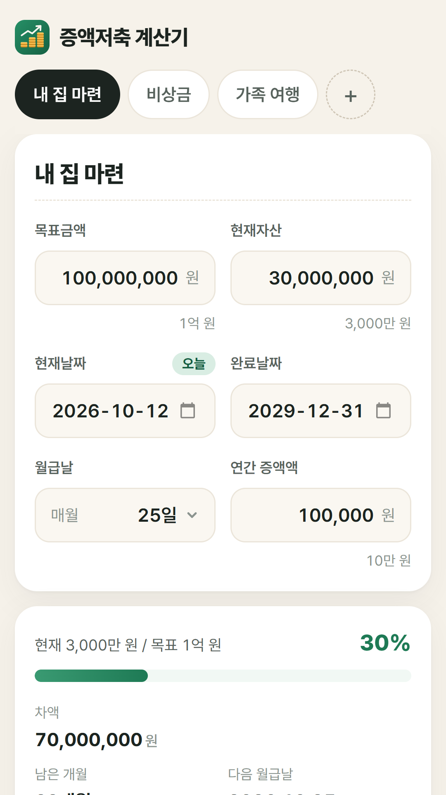
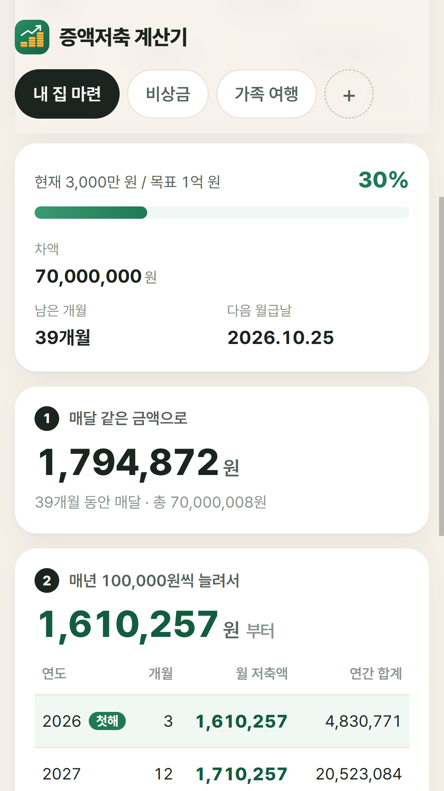
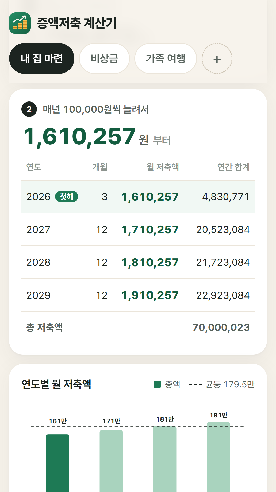

# 증액저축 계산기 (Step-up Savings)

> 목표금액까지 매달 얼마씩, 해마다 얼마나 늘려 모으면 되는지 계산해 주는 앱

  

---

## 📖 소개

"3년 뒤까지 1억 모으려면 매달 얼마씩 넣어야 하지?"

증액저축 계산기는 목표금액, 지금 가진 돈, 완료날짜, 월급날만 넣으면 두 가지 저축 방법의 월 저축액을 바로 보여 줍니다.

1. **균등 저축**: 끝날 때까지 매달 같은 금액을 모으는 방법
2. **증액 저축**: 처음엔 적게 시작해서, 연봉이 오르듯 해마다 정한 금액만큼 월 저축액을 늘려 가는 방법

월급날을 기준으로 남은 개월 수를 세기 때문에 "이번 달 월급으로도 넣을 수 있는지"까지 반영됩니다. PC(Windows)와 안드로이드 휴대폰에서 쓸 수 있고, 회원가입이나 인터넷 연결 없이 동작합니다.

  
  
  

## 📱 다운로드

[**최신 버전 내려받기 (GitHub Releases)**](https://github.com/kang-labs/step-up-savings/releases/latest) 페이지 아래쪽 **Assets** 에서 내 기기에 맞는 파일을 고르세요.

| 기기 | 파일 | 지원 환경 |
|---|---|---|
| PC | `step-up-savings-v○.○.○-windows.exe` | Windows 10 이상 (64비트) |
| 안드로이드 | `step-up-savings-v○.○.○.apk` | Android 7.0 이상 |

### PC(Windows)

- 설치 과정 없이 exe 파일을 더블클릭하면 바로 열립니다. 실행할 때마다 압축을 풀기 때문에 창이 뜨기까지 몇 초 걸릴 수 있습니다.
- "Windows의 PC 보호" 파란 창이 뜨면 **추가 정보 → 실행** 을 누르세요. 개인이 만든 앱이라 유료 인증서가 없어서 뜨는 안내입니다.

### 안드로이드

- 휴대폰 브라우저에서 apk 파일을 내려받아 엽니다.
- "출처를 알 수 없는 앱 설치" 허용을 묻으면 허용하세요. Play 스토어 밖에서 받은 앱이라 뜨는 안내입니다.
- 홈 화면에 **증액저축** 아이콘이 생깁니다.

## ✨ 주요 기능

- **두 가지 저축 방법 한눈에 비교**: 균등 저축의 월 저축액과, 증액 저축의 첫해 월 저축액을 나란히 보여 줍니다.
- **연도별 표**: 증액 저축을 고르면 해마다 몇 개월 동안, 매달 얼마씩, 1년에 총 얼마를 모으는지 표로 보여 줍니다.
- **연도별 차트**: 해마다 늘어나는 월 저축액을 막대로, 균등 저축 금액을 점선으로 그려 차이를 쉽게 볼 수 있습니다.
- **진행률 요약**: 목표 대비 지금 모은 비율(%), 남은 금액, 남은 개월 수, 다음 월급날을 보여 줍니다.
- **여러 플랜 관리**: "내 집 마련", "비상금", "가족 여행"처럼 목표별로 플랜을 탭으로 만들고 이름을 붙일 수 있습니다.
- **자동 저장**: 입력한 값은 바로 저장되어 앱을 껐다 켜도 그대로 남아 있습니다.
- **항상 오늘 기준**: 현재날짜는 기본으로 오늘이 들어가고, 날이 바뀌면 남은 개월 수도 자동으로 다시 계산됩니다. 다른 날짜를 기준으로 계산해 보고 싶으면 직접 바꿀 수 있고, **오늘로** 를 누르면 돌아옵니다.
- **읽기 쉬운 금액**: 입력할 때 자동으로 콤마가 붙고, 아래에 `1억 원`, `3,000만 원` 처럼 한글 단위로도 보여 줍니다.
- **다양한 화면 크기**: 휴대폰, 폴더블, 태블릿, PC 창 크기에 맞춰 한 열 또는 두 열로 배치가 바뀝니다.

## 🚀 사용 방법

1. **목표금액**: 모으고 싶은 금액을 입력합니다.
2. **현재자산**: 이 목표를 위해 지금까지 모은 금액을 입력합니다.
3. **현재날짜·완료날짜**: 언제부터 언제까지 모을지 정합니다. 현재날짜는 오늘로 자동 입력됩니다.
4. **월급날**: 저축하는 날(보통 월급날)을 고릅니다. 31일처럼 그 달에 없는 날은 그 달 마지막 날로 계산합니다.
5. **연간 증액액**: 증액 저축에서 해마다 월 저축액을 얼마씩 늘릴지 입력합니다.

입력하는 즉시 아래(PC 에서는 오른쪽)에 결과가 나옵니다. 위쪽 **+** 탭으로 플랜을 더 만들 수 있고, 필요 없는 플랜은 맨 아래 **플랜 삭제** 로 지웁니다.

### 계산 예시

2026년 10월 12일부터 2029년 12월 31일까지, 매월 25일에 저축해서 3,000만 원을 1억 원으로 만들 때 (남은 금액 7,000만 원, 39개월):

| 방법 | 월 저축액 |
|---|---|
| 균등 저축 | 매달 **1,794,872원** |
| 증액 저축 (매년 10만 원씩) | 2026년 1,610,257원 → 2027년 1,710,257원 → 2028년 1,810,257원 → 2029년 1,910,257원 |

## 🧮 계산 방법

- **남은 개월 수**: 현재날짜 다음부터 완료날짜까지 돌아오는 월급날의 수입니다. 오늘이 이번 달 월급날 전이면 이번 달도 포함하고, 월급날 당일이거나 지났으면 다음 달부터 셉니다.
- **균등 저축**: 남은 금액 ÷ 남은 개월 수
- **증액 저축**: 첫해 월 저축액을 정하고, 해마다 연간 증액액만큼 늘렸을 때 모든 달의 저축액을 더한 값이 남은 금액과 같아지도록 첫해 금액을 구합니다.
- 모든 월 저축액은 **1원 단위로 올림** 하므로 실제로 모이는 총액은 목표보다 몇 원 많을 수 있습니다.

## ⬆️ 업데이트

새 버전이 나오면 [Releases](https://github.com/kang-labs/step-up-savings/releases/latest) 에서 같은 방법으로 내려받으세요. 앱 안에서 자동으로 업데이트하지는 않습니다.

- **PC**: 새 exe 파일로 바꿔서 실행하면 됩니다. 저장된 플랜은 그대로 남아 있습니다.
- **안드로이드**: 기존 앱을 지우지 말고 새 apk 를 그대로 설치하세요. 덮어서 설치되고 저장된 플랜도 남아 있습니다.

## 🔐 개인정보

- 개인정보를 수집하지 않으며 회원가입이 없습니다.
- 입력한 값은 **내 기기 안에만** 저장되고 어디로도 전송되지 않습니다. 광고나 이용 분석 도구도 없습니다.
- 저장 위치: PC 는 `%APPDATA%\증액저축계산기` 폴더, 안드로이드는 앱 내부 저장소입니다. 안드로이드에서 앱을 지우면 저장된 플랜도 함께 지워집니다.

## ⚠️ 유의사항

이 앱은 저축 계획을 세우기 위한 **참고용 계산기** 입니다. 예금·적금 이자와 세금은 계산에 넣지 않습니다. 실제 금융 상품에 가입할 때는 해당 금융기관의 조건을 확인하세요.

## 🛠️ 개발

코드를 고치고 배포하는 방법은 [개발 안내](docs/development.md) 를 보세요.

## 📄 저작권

© 2026 Bible Kang. 앱은 누구나 자유롭게 내려받아 쓸 수 있습니다. 이 저장소의 소스 코드는 저작권자의 허락 없이 복제·수정·재배포할 수 없습니다.
